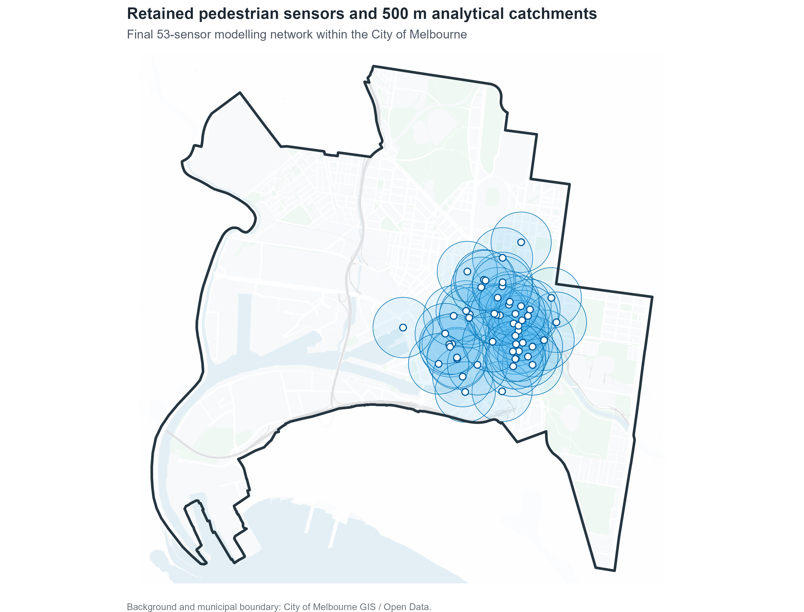
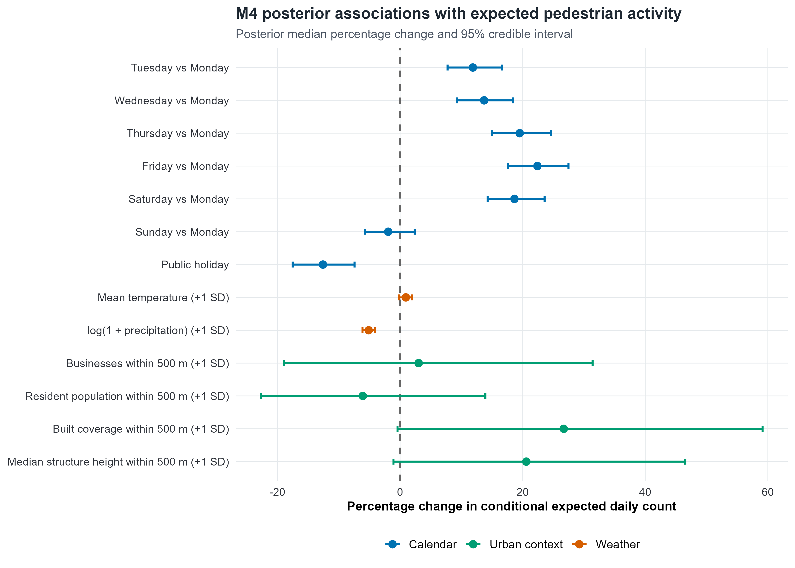

# Bayesian Hierarchical Modelling of Pedestrian Activity in Melbourne

A Bayesian analysis of daily pedestrian activity across the City of Melbourne, combining temporal, weather, land-use and built-environment information in a hierarchical count-modelling framework.

This project was developed as part of my MSc in Data Science. The main question I wanted to address was how much of the variation in pedestrian activity can be associated with observed temporal and urban-context variables, and how much variation remains unexplained between monitoring locations and across dates.

**Full interactive report:**
https://sohrab-prs.github.io/melbourne-pedestrian-bayesian/

<p align="center">
  
</p>

## Research question

> How do temporal conditions and characteristics of the surrounding urban environment explain variation in pedestrian activity across central Melbourne, and how much unexplained heterogeneity remains between pedestrian monitoring locations?

The analysis is observational, so the estimated urban-environment effects are interpreted as associations rather than causal effects.

## Data and study design

The unit of analysis is a **pedestrian sensor × calendar day**.

The final modelling dataset contains:

- **18,671 complete sensor-days**
- **53 retained pedestrian monitoring locations**
- **364 represented dates in 2025**
- a **500 m circular catchment** around each sensor

Daily pedestrian counts were constructed only from complete 24-hour records. Incomplete sensor-days were excluded rather than imputed in the primary analysis.

The project combines publicly available data from:

- City of Melbourne Pedestrian Counting System
- City of Melbourne CLUE business and residential datasets
- City of Melbourne building footprints
- Australian Bureau of Statistics 2021 Census
- Open-Meteo / ERA5 historical weather data
- Victorian public-holiday information

Source provenance and reference years are documented in [`data/metadata/data_sources.csv`](data/metadata/data_sources.csv).

## Model development

I fitted four Bayesian count models in **R + JAGS**:

| Model | Specification | Main purpose |
|---|---|---|
| **M1** | Poisson regression | Baseline count model |
| **M2** | Negative Binomial regression | Account for observation-level overdispersion |
| **M3** | Hierarchical Negative Binomial + sensor random effects | Capture persistent between-sensor heterogeneity |
| **M4** | Hierarchical Negative Binomial + sensor and day random effects | Capture both persistent sensor differences and shared day-level variation |

The final model includes:

- day of week
- public holidays
- mean temperature
- log-transformed precipitation
- business count within 500 m
- resident population within 500 m
- built coverage within 500 m
- median structure height within 500 m
- sensor random effects
- date random effects

Continuous predictors were standardized before modelling.

The original analysis plan is retained in [`docs/original_analysis_plan.md`](docs/original_analysis_plan.md). The final M4 specification differs from the initial plan because posterior predictive checking of M3 showed that shared date-level variation was still under-reproduced. A residual spatial model was considered afterwards but was not fitted because the remaining spatial dependence was weak.

## Main results

The main statistical finding is that pedestrian counts require **both overdispersion and hierarchical structure**.

| Model | DIC |
|---|---:|
| M1 Poisson | 89,255,259 |
| M2 Negative Binomial | 380,409 |
| M3 Hierarchical Negative Binomial | 350,594 |
| **M4 Sensor-Day Hierarchical Negative Binomial** | **348,781** |

M3 reproduced persistent differences between sensors well, but under-reproduced shared variation across dates. Adding the day random effect in M4 increased date-mean posterior-predictive coverage from **65.7% to 99.5%**, while retaining **100% sensor-mean coverage**.

Under the final M4 model:

- expected pedestrian activity is higher from **Tuesday to Saturday** than on Monday;
- **Friday** has the largest weekday contrast, about **22.4% higher** than Monday;
- public holidays are associated with about **12.6% lower** expected activity;
- a one-standard-deviation increase in log-transformed precipitation is associated with about **5.1% lower** expected activity;
- built coverage and median structure height have positive posterior medians, but their 95% credible intervals narrowly include zero, so I treat these as **suggestive rather than conclusive associations**;
- persistent between-sensor heterogeneity remains substantial (`sigma_sensor ≈ 0.60`);
- shared day-level heterogeneity is smaller but clearly present (`sigma_day ≈ 0.096`).

<p align="center">
  
</p>

## Model checking and validation

The project includes several layers of model checking and implementation validation:

- prior predictive simulation
- four-chain MCMC convergence diagnostics
- R-hat and effective sample size checks
- full-design simulated-data parameter recovery
- posterior predictive checks at observation, sensor and date levels
- DIC model comparison
- residual spatial-autocorrelation analysis using Moran's I
- frequentist Negative Binomial mixed-model sensitivity analysis

The final M4 fit passed the pre-specified MCMC diagnostic thresholds. The first full-design M4 recovery replicate narrowly missed the pre-specified core-coverage criterion; a single independently seeded confirmation replicate, run without changing the model, priors, MCMC settings or thresholds, passed. Both results are documented in the full report.

Residual spatial dependence in the fitted sensor effects was weak. I therefore did not add a more complex spatial random-effect model solely for additional model complexity.

## Repository structure

```text
.
├── R/                  # Numbered data, modelling, validation and reporting scripts
├── models/jags/        # JAGS model definitions
├── data/
│   ├── metadata/       # Data-source provenance
│   └── processed/      # Analysis-ready datasets
├── outputs/
│   ├── figures/        # Analytical and publication figures
│   └── tables/         # Model summaries, diagnostics and derived results
├── docs/
│   ├── index.html      # Published interactive report (GitHub Pages)
│   └── original_analysis_plan.md
├── report/
│   ├── final_report.qmd
│   ├── report_style.css
│   └── references.bib
├── renv.lock
└── README.md
```

Raw source downloads, intermediate spatial objects, large posterior-sample files and machine-specific execution logs are intentionally excluded from version control.

## Reproducibility

### Software

The final analysis used:

- R 4.6.1
- JAGS 4.3.2
- `rjags`
- `coda`
- `sf`
- `dplyr`
- `ggplot2`
- `mgcv`
- Quarto

R package versions are recorded in [`renv.lock`](renv.lock).

### Restore the R environment

```r
install.packages("renv")
renv::restore()
```

JAGS must be installed separately on the system.

### Run the analysis

The scripts in `R/` are numbered in analysis order. They cover:

1. data acquisition and cleaning;
2. spatial preprocessing and 500 m catchment construction;
3. feature engineering;
4. exploratory analysis and predictor selection;
5. prior predictive validation and parameter recovery;
6. Bayesian model fitting;
7. MCMC diagnostics and model comparison;
8. posterior predictive checking;
9. residual spatial analysis;
10. inference, prediction and frequentist sensitivity analysis;
11. final report figures.

Model fitting and the full-design recovery experiments are computationally intensive.

### Render the report

```bash
quarto render report/final_report.qmd
```

The rendered local report is then copied to `docs/index.html` for GitHub Pages.

## Full report

The complete report, including model equations, prior specification, diagnostics, parameter-recovery experiments, posterior predictive checks, maps, predictions and limitations, is published here:

**https://sohrab-prs.github.io/melbourne-pedestrian-bayesian/**

The Quarto source is available at [`report/final_report.qmd`](report/final_report.qmd).

## Limitations

The main limitations are:

- the analysis is observational and does not establish causal effects;
- the pedestrian monitoring network is not a random spatial sample of Melbourne;
- contextual datasets use different reference years;
- spatial coefficients are informed by 53 unique sensor locations rather than 18,671 independent locations;
- M4 still produces a somewhat heavier observation-level upper tail than observed;
- posterior predictive checks mainly assess in-sample reproduction of the fitted hierarchical structure rather than external predictive performance.

## Future work

Possible extensions include external validation on a future period, explicit event and public-transport disruption variables, sensitivity analysis for alternative catchment distances, and richer spatial or hourly models where supported by the data.

## Author

**Sohrab Seyyedi Parsa**

MSc Data Science

MSc Urban Planning

## Data and code licensing

The analysis code is released under the MIT License. Third-party datasets remain subject to the terms and licences of their original providers; see [`data/metadata/data_sources.csv`](data/metadata/data_sources.csv).
